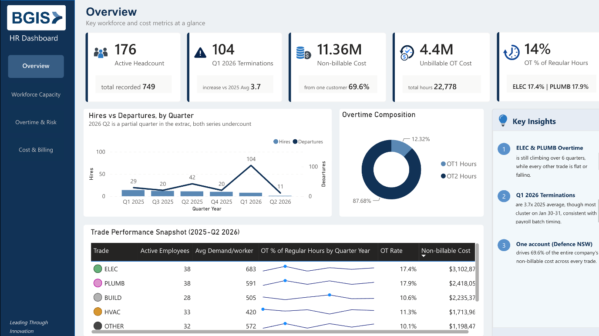
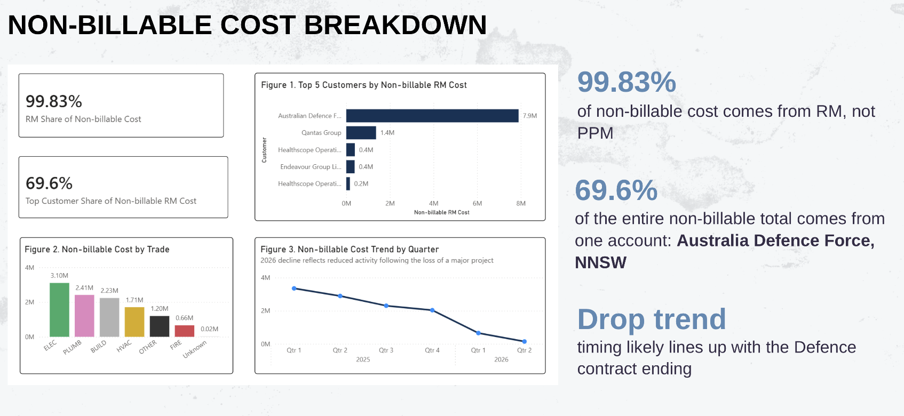
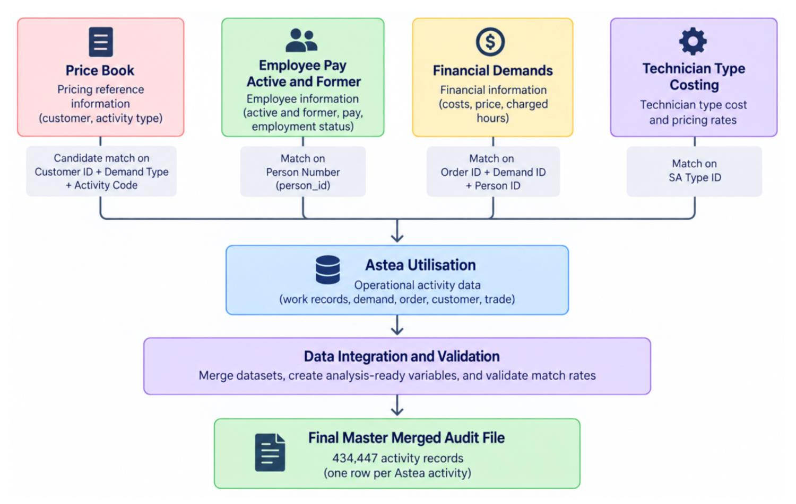
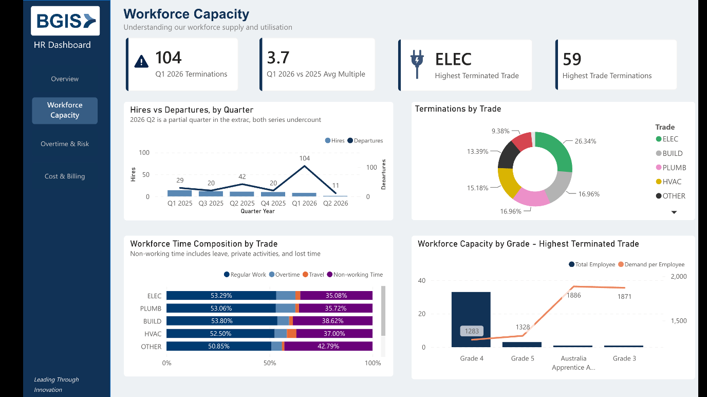
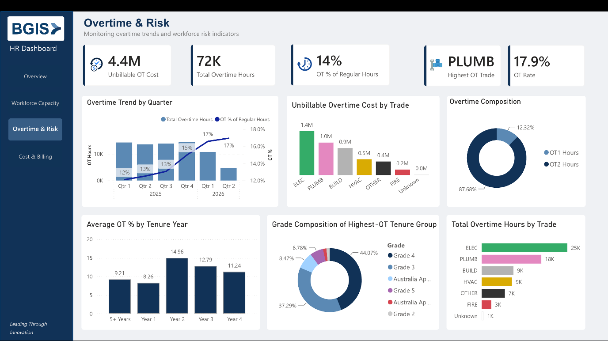
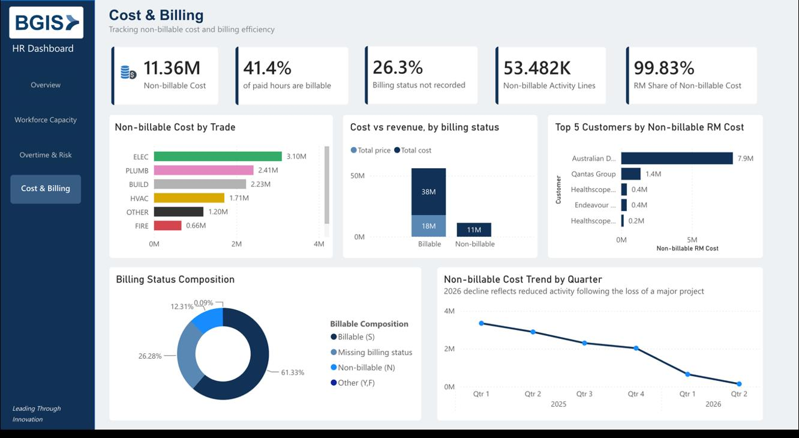
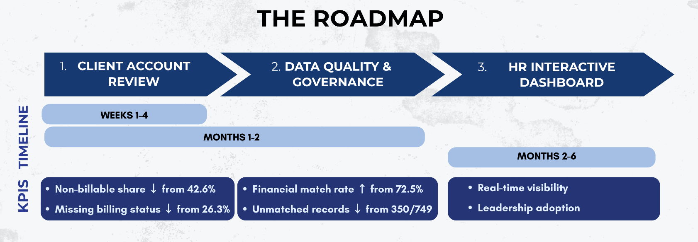

<div align="center">

# BGIS Workforce Analytics

**Tracing $11.36M in non-billable workforce cost down to one client account.**

[](dashboards/)
[](notebooks/Data_Cleaning_and_Merge_Guide.ipynb)
[](notebooks/Data_Cleaning_and_Merge_Guide.ipynb)


[Overview](#overview) · [Key findings](#key-findings) · [Approach](#approach) · [Dashboard](#hr-interactive-dashboard) · [Recommendations](#recommendations) · [Repository](#repository-structure)



</div>

A real client engagement for **BGIS**, a global integrated facilities management provider, sponsored by its Executive Director, People & Culture APAC. The brief was to find how recruitment, retention, onboarding, scheduling and utilisation were affecting operating margin, and to turn that into evidence-based recommendations.

The headline result: what looked like a company-wide billing governance crisis was actually **one contract and one work-type conversion issue**. That turned a diffuse, hard-to-fund problem into a scoped, fixable one.

> [!NOTE]
> This was delivered for a real client, not as a case study. It was completed by Group BW1 (seven student consultants) as part of MIS399 at Deakin University, with two client presentations (27 Aug and 17 Sep 2026) and a final report.

## Overview

| | |
|---|---|
| **Client** | BGIS, global facilities management (APAC) |
| **Objective** | Find how workforce dynamics affect operating margin |
| **Data** | 5 raw operational datasets, ~2,500 employees, 434,447 activity records |
| **My role** | Project Manager across all three analysis streams |
| **Tools** | Power BI · Power Query · DAX · Python (pandas) · Excel |
| **Skills** | Data cleansing & governance · Data modelling (join architecture) · Workforce analytics |

The work was split into three parallel analysis streams:

- **Vacancies & Pay**: overtime cost and termination patterns
- **Workforce Underutilisation**: sources of non-billable cost and the size of the recovery opportunity
- **Capability Gaps**: workforce plans for high-pressure trades, based on overtime and tenure

As Project Manager I coordinated all three streams, and owned the data cleaning and master merge pipeline and the Power BI HR dashboard.

## Key findings

| Finding | Detail |
|---|---|
| **Termination surge** | Q1 2026 terminations hit **102**, a **3.7x** spike against the 2025 quarterly average. This contradicts the client's internal "lowest turnover in a decade" narrative. |
| **Non-billable cost** | **$11.36M** in non-billable cost, with **26.3%** of activity lines missing billing status entirely. At first this looked like a company-wide billing discipline problem. |
| **Root cause** | **69.6%** of that $11.36M traces to a single client account (Defence-NNSW). **99.83%** of non-billable cost comes from Reactive Maintenance (RM), not Planned Preventative Maintenance (PPM). |
| **Data-quality catch** | **114,157** rows flagged as "unmatched" were really a mistagged category (Private Activities), not genuine data failures. |
| **Trade pressure** | ELEC and PLUMB lead on headcount, overtime rate and non-billable cost. |



## Approach

### 1. Clean without altering the source

Each of the five datasets was cleaned using a **Detect → Standardise → Validate** method aligned to ISO/IEC 25012. Raw values are kept next to standardised fields, so any cleaned value can be traced back to its source. Identifiers are cast to text to protect leading zeros and stop Excel number formats from silently breaking joins.

> [!IMPORTANT]
> The governing principle was **flag, not fix**. Anomalies such as "Unknown" trade, missing billing status and unmatched keys were logged and raised with the client rather than quietly corrected or estimated around. The client called out this honesty as a strength in feedback on both presentations.

### 2. Link five systems into one master file

Astea Utilisation is the central hub. Every other dataset joins to it on a validated key, and match rates were reviewed before any joined data was interpreted.



| Relationship | Key | Match rate |
|---|---|---|
| Utilisation → Financial Demands | Order ID + Demand ID + Person ID | 72.5% |
| Utilisation → Technician Type Costing | SA Type ID | 100.0% |
| Activity / Financial → Price Book | Customer ID + Demand Type + Activity Code (candidate) | 61.2% |

The pipeline in [`notebooks/Data_Cleaning_and_Merge_Guide.ipynb`](notebooks/Data_Cleaning_and_Merge_Guide.ipynb) produces three audit outputs:

- `MIS399_master_merged_audit.csv`: the master file, one row per Astea activity (434,447 rows)
- `relationship_quality.csv`: match percentages for every relationship
- `unmatched_utilisation_to_financial.csv`: unmatched keys, kept for investigation rather than dropped

> [!TIP]
> Financial values repeat across activity rows in the master file. Aggregate to the Order + Demand + Person grain before summing cost or price.

### 3. Decompose the first number, don't stop at it

The first pass surfaced $11.36M in non-billable cost. After client feedback on Presentation 1, the team broke it down by trade, client account and work type. That decomposition revealed the Defence-NNSW concentration and the RM-vs-PPM split.

## HR Interactive Dashboard

A four-page Power BI report, with each page mapped to one of BGIS's original business questions.

### Overview

*Where should we pay attention first?* Headcount, terminations, non-billable cost and overtime on one screen, with key insights alongside.


### Workforce Capacity

*Do we have the right workforce in the right areas?* Hires vs departures, terminations by trade, how time is split across each trade, and capacity by grade.



### Overtime & Risk

*Where is workload pressure becoming costly or unsustainable?* The overtime trend, unbillable overtime cost by trade, and overtime patterns by tenure and grade.



### Cost & Billing

*What drives non-billable cost, and where is the biggest recovery opportunity?* Non-billable cost by trade, cost vs revenue, billing status composition, and the Defence-NNSW account concentration.



To explore it, open [`dashboards/BW1_HR_Interactive_Dashboard.pbix`](dashboards/BW1_HR_Interactive_Dashboard.pbix) in [Power BI Desktop](https://powerbi.microsoft.com/desktop/) (Windows). To rebuild it from scratch, including the data model and DAX measures, see the [dashboard guide](docs/BGIS_PowerBI_Dashboard_Guide.md).

## Recommendations

The recommendations are sequenced by data readiness. First stop what is losing money now, then make the data trustworthy, then build ongoing visibility.



| Stage | Timeline | Actions |
|---|---|---|
| **1. Client account review** | Weeks 1–4 | Audit and enforce the Defence-NNSW and BAE Systems contract terms. Tag billing status at job closure. |
| **2. Data quality & governance** | Months 1–2 | Standardise naming and ID conventions across the five source systems. Fix the mistagged Private Activities category. |
| **3. HR Interactive Dashboard** | Months 2–6 | Deploy a live Power BI dashboard on BGIS's existing IFS Cloud environment. |

**KPIs tracked:** non-billable share (baseline 42.6% ↓), missing billing status (26.3% ↓), financial match rate (72.5% ↑) and unmatched employee records (350 / 749 ↓).

> [!WARNING]
> Termination and non-billable figures are based on matched employee records only. The fall in non-billable cost in 2026 lines up with the Defence contract ending, but that is a timing correlation and still needs confirming with BGIS.

## Reflection

- **Resist reporting the first number.** $11.36M non-billable was a real finding, but the useful one only came out after decomposing it. Client feedback after Presentation 1 pushed us to do that, and it turned a vague "billing problem" into a specific, actionable one.
- **Flag data-quality issues openly.** Surfacing missing billing status and unmatched records, instead of fixing or estimating around them quietly, built trust with the client. They valued that explicitly in feedback on both presentations.

## Repository structure

```text
├── notebooks/
│   └── Data_Cleaning_and_Merge_Guide.ipynb   # Cleaning, standardisation and master merge (Python)
├── dashboards/
│   ├── BW1_Initial_Findings.pbix             # Presentation 1: data quality and initial findings
│   ├── BW1_Further_Findings.pbix             # Presentation 2: further findings and recommendations
│   └── BW1_HR_Interactive_Dashboard.pbix     # Final four-page HR dashboard
├── docs/
│   └── BGIS_PowerBI_Dashboard_Guide.md       # Step-by-step dashboard build guide (model + DAX)
├── report/
│   └── BW1_Final_Report.pdf                  # Final client report
└── assets/                                   # Images used in this README
```

The raw source data and merged outputs are in the companion repository, [ashlynn-05/MIS399_DATA](https://github.com/ashlynn-05/MIS399_DATA).

### Run the cleaning pipeline

The notebook is written for Google Colab with the raw files in a Google Drive folder.

1. Put the five raw files (`Astea_Utilisation_Data.xlsx`, `Employee_Pay_Report.xlsx`, `Financial_Demands.xlsx`, `Technician_Type_Costing.xlsb`, `Price_Book_Data.xlsb`) in `MyDrive/MIS399/`.
2. Open the notebook in Colab and run all cells. `pyxlsb` is installed in the first cell.
3. The outputs are written to `MyDrive/MIS399/cleaned_standardised_outputs/`.

---

<div align="center">

Built by **Group BW1**: Lynn Le, Shenal Nathan Witharana, Thuong Luong, Divya Hasandi Hewawickrama, Jade Dang, Yasiru Dinara Abeyawardena and Quynh Hoang.

</div>
